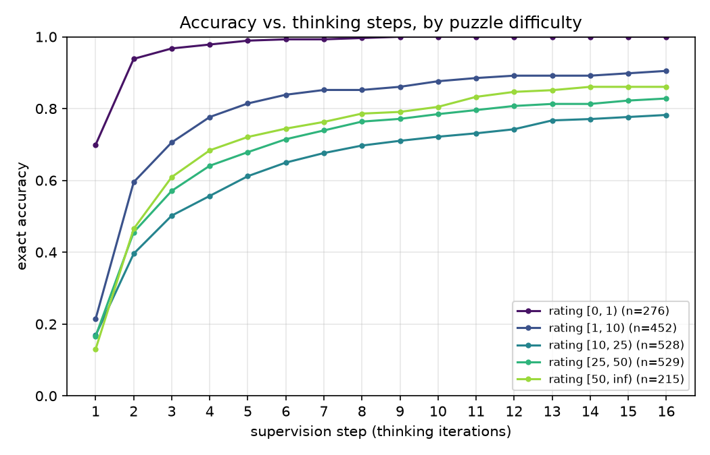

# CS440-Final-Project

## Topics

1. Searchless models
    * A model architecture that strives to only do a single forward pass, replacing expensive MCTS.
2. Thinking models
    * A model architecture that mimics an LLMs ability to output thinking tokens allowing the model to dictate how long to think before acting.

Artificial intelligence has transitioned from hand crafted algorithms and heuristics to linear models and finally to learned function approximation via machine learning. This is, almost, fully realized in reinforcement learning where the machine gathers data their own data to train their own models... but a human still makes a hand-crafted evaluation function. A human still writes a heuristic that tells the model the error of the prediction. 

## Project Summary

This project studies whether a **recursive thinking model** can replace explicit tree search (MCTS) in structured domains such as zero-sum board games.

Transformers made sequence processing parallel across *width*: every position attends to every other at once. They did not do the same for *depth*. A fixed stack of layers still limits how many dependent reasoning steps a model can take. Search needs both:

* **Breadth** (which branches to consider): parallelizes well, and attention handles it.
* **Depth** (multi-step lookahead): sequential by nature.

Our model keeps attention's parallelism across the board and adds sequential depth back with weight-tied recursive iterations, as in TRM (Tiny Recursive Models) or looped transformers. In each iteration the model updates its latent representation of every board cell at once. This is analogous to Value Iteration Networks, which run Bellman backups over all states in parallel, rather than to MCTS, which expands one path at a time. The model can also learn when to halt, so it spends more thinking steps on harder positions.

**Testbed.** We use solved games, starting with Connect Four on a board too large to memorize. A perfect solver gives the true value of every position and its *depth*: how many moves until a forced win. With these labels we can measure whether extra thinking steps move predictions toward the true answer.

**Compared against.** A policy/value network with MCTS at matched compute (FLOPs and wall-clock time).

## Hypothesis

> A weight-tied recursive transformer does something like parallel value iteration in latent space. The number of iterations it needs grows with the tactical depth of the position.

**Test.** Label each position with the solver's moves-to-win *d*. Plot move accuracy against the number of thinking iterations *K*, separately for each *d*. If accuracy on depth-*d* positions jumps once *K* reaches about *d*, and stays flat below that, that is evidence of latent search rather than a bigger model. We will also check whether extra iterations can substitute for extra parameters (model size vs. *K*), and whether the learned halting step tracks position difficulty.

## Benchmarks

No single package offers both a suite of environments and exact solver labels, so evaluation has two tiers plus a sanity check.

### Sanity check: recursive-reasoning benchmarks

Before moving to games, reproduce TRM's published results on **Sudoku-Extreme** and **Maze-Hard (30×30)**, the standard benchmarks in the recursive-reasoning literature (HRM, TRM). Matching those numbers confirms the recursive model is implemented correctly.

### Tier 1: Pgx suite (thinking vs. MCTS at matched compute)

[Pgx](https://github.com/sotetsuk/pgx) (NeurIPS 2023 Datasets & Benchmarks) is a suite of JAX game simulators that run many games in parallel on accelerators. It has one `pgx.make(env_id)` interface across games. We fit the same model architecture to each two-player, zero-sum, perfect-information game:

* Connect Four, Othello, Hex, Gardner chess (5×5), Animal Shogi, Go 9×9

**Metric:** win rate / Elo against:
* Pgx's pretrained Gumbel AlphaZero baselines (Animal Shogi, Gardner chess, Go 9×9, Hex, Othello)
* our own MCTS agent (built with DeepMind's [mctx](https://github.com/google-deepmind/mctx)) at matched FLOPs and wall-clock time

**Question answered:** does the thinking model match or beat MCTS at equal compute, across many games?

### Tier 2: exact-oracle diagnostics (the depth hypothesis)

Run only where an exact solver can label positions:

* **Connect Four 7×6** (primary): about 4.5 trillion legal positions, too many to memorize. [Pascal Pons' solver](https://connect4.gamesolver.org) gives an exact score per move, and the score encodes how many moves until a forced win (the depth label *d*). Evaluate on Pons' 6,000-position test protocol (split by game stage and difficulty) and the [connect4-pons-eval](https://huggingface.co/datasets/davidquarel/connect4-pons-eval) dataset.
* **Chess endgames** (stretch): Syzygy tablebases give exact distance-to-mate for positions with 7 or fewer pieces. DeepMind's [searchless_chess](https://github.com/google-deepmind/searchless_chess) / ChessBench provides training data and searchless baselines.

**Metric:** fraction of moves that are optimal according to the solver, plotted against thinking steps *K*, separately for each depth *d*.

**Question answered:** does accuracy on depth-*d* positions jump once *K* reaches about *d*?

### Notes

* Pgx needs JAX, and JAX's GPU support on Macs is experimental. Use CPU for small games, or Colab or another GPU machine for training.
* [OpenSpiel](https://github.com/google-deepmind/open_spiel) is a more established alternative with more games and built-in AlphaZero/MCTS, but it is much slower than Pgx.

## Code

Python package in `src/cs440_final_project/` (managed with [uv](https://docs.astral.sh/uv/)):

| File | Contents |
|---|---|
| `models.py` | `TRM` (recursive thinking model, matches the official implementation exactly and loads its checkpoints), the `ds-only` ablation (`n=0`: deep supervision without latent recursion), and `Direct` (one-pass transformer baseline) |
| `data.py` | Sudoku-Extreme and Maze-Hard loaders with validity-preserving augmentation |
| `train.py` | `trm-train`: official TRM training loop (rolling batch, ACT halting with exploration, EMA, stablemax loss) |
| `evaluate.py` | `trm-eval`: per-step evaluation plus the thinking-steps vs. difficulty analysis |
| `scripts/verify_against_official.py` | Checks our TRM against the official code, output by output |

```bash
uv sync
uv run pytest
```

### Sanity check: pretrained TRM (no training)

There are no official TRM weights, so we use a community checkpoint trained with the official code ([MaximeILL/GAR_ckpts](https://huggingface.co/MaximeILL/GAR_ckpts), TRM-MLP, 5.03M parameters, reported 86.5% exact accuracy on the full Sudoku-Extreme test split).

```bash
mkdir -p data/ckpt
curl -L -o data/ckpt/TRM-MLP-Sudoku-Extreme.pt https://huggingface.co/MaximeILL/GAR_ckpts/resolve/main/TRM-MLP-Sudoku-Extreme.pt
curl -L -o data/sudoku_test.csv https://huggingface.co/datasets/sapientinc/sudoku-extreme/resolve/main/test.csv
uv run trm-eval --official data/ckpt/TRM-MLP-Sudoku-Extreme.pt --num 2000 --seed 0 --device cpu
```

Writes `runs/eval-*/results.npz` (per-puzzle, per-step correctness, halting logits, difficulty ratings), `summary.json`, and `depth_vs_difficulty.png`. Copies of our results are in `results/sanity-check/`.

* **Implementation check:** on CPU in fp32, our `TRM` produces exactly the same logits as the official code at all 16 supervision steps (`scripts/verify_against_official.py`).

**Results** (2,000 random test puzzles, seed 0):

| Device | Exact accuracy (16 steps) | Accuracy at learned halting step | Mean halting step |
|---|---|---|---|
| CPU (fp32) | **86.05%** | 84.30% | 4.90 |
| Apple MPS (fp32) | 85.70% | 84.05% | 4.92 |
| Reported for this checkpoint (full test split) | 86.50% | | |

**MPS vs. CPU.** The recursion runs 672 layer applications over 16 steps and amplifies small floating-point differences. MPS and CPU disagree on 115 of 2,000 puzzles (5.8%), but in both directions (61 solved only on CPU, 54 only on MPS). Net accuracy differs by 0.35 points, within sampling error (±0.8 points). We use MPS for development and CPU/CUDA for final numbers.

**Thinking steps vs. difficulty** (CPU; rating = tdoku backtracks needed to solve the puzzle):

| Rating | n | Accuracy after step 1 | Accuracy after step 16 | Mean steps to solve (solved puzzles) | Mean learned halting step |
|---|---|---|---|---|---|
| 0 | 276 | 69.9% | 100.0% | 1.45 | 1.47 |
| 1–9 | 452 | 21.5% | 90.5% | 2.91 | 4.12 |
| 10–24 | 528 | 16.9% | 78.2% | 3.88 | 6.50 |
| 25–49 | 529 | 16.6% | 82.8% | 3.52 | 5.65 |
| 50+ | 215 | 13.0% | 86.0% | 3.51 | 5.21 |



What this shows, before we train anything:

* **Harder puzzles need more thinking steps.** Puzzles that need no backtracking are solved in about 1.5 steps; puzzles that need backtracking take 3–4 steps. Spearman correlation between rating and steps to solve is 0.29.
* **The model knows when to stop.** The learned halting step tracks difficulty as well (Spearman 0.31). Halting early costs only 1.75 points of accuracy compared with always running all 16 steps.
* **The relationship is not monotonic past the easiest puzzles.** Puzzles rated 10–24 are the hardest for TRM, not those rated 50+. tdoku's backtrack count measures difficulty *for a backtracking solver*, which is only a rough proxy for the depth TRM needs. Connect Four's exact moves-to-win labels (Tier 2) avoid this problem.

### Connect Four dataset (Tier 2 labels)

```bash
scripts/setup_connect4_solver.sh                       # fetch + build Pascal Pons' solver (AGPL-3.0, kept in third_party/)
uv run c4-data --num 1000000 --test-per-bucket 2000     # ~12 min on an 8-core laptop
```

The script samples unique, non-terminal positions by random play: 80% from "safe" random play, which blocks threats and never hands the opponent an immediate win, and 20% from uniform random play. Each position is labeled with the solver's exact score for every column. From those scores we derive the optimal moves, the game value and **d, the number of plies until the game ends under optimal play**. The formula for d is in `connect4.py`, and `tests/test_connect4.py` checks it against exhaustive search. The test set has the same number of positions in each depth bucket (1, 2, 3–4, 5–6, 7–8, 9–12, 13–16, 17–24, 25+, and draws). The output files are `data/c4_train.npz` and `data/c4_test.npz`.

### Training (long run, on a GPU server)

```bash
uv sync
uv run trm-train --task sudoku --model trm --compile        # TRM-MLP, paper settings (~65k steps)
uv run trm-train --task sudoku --model ds-only --compile    # ablation: no latent recursion
uv run trm-train --task sudoku --model direct --compile     # one-pass baseline
uv run trm-eval --ckpt runs/<run>/ckpt.pt --num 2000         # same analysis as the sanity check
```

The first run downloads the Sudoku-Extreme training CSV (about 720 MB) from Hugging Face and caches it as `data/sudoku_train.npz`. Defaults match the official config: batch 768, lr 1e-4, weight decay 1.0, 2000 warmup steps, EMA 0.999, bf16 on CUDA. Logs and checkpoints go to `runs/<run-name>/`.

## References

* https://github.com/autogluon/tabarena
* https://github.com/google-deepmind/disco_rl
* https://github.com/facebookresearch/coconut
* https://github.com/samsungsailmontreal/tinyrecursivemodels
* https://github.com/machinestein/Deep-Improvement-Supervision
* https://arxiv.org/pdf/2605.11262
* https://github.com/sotetsuk/pgx (Pgx, arXiv:2303.17503)
* https://github.com/google-deepmind/mctx
* https://connect4.gamesolver.org (Pascal Pons' Connect Four solver)
* https://huggingface.co/datasets/davidquarel/connect4-pons-eval
* https://github.com/google-deepmind/searchless_chess (arXiv:2402.04494)
* https://github.com/google-deepmind/open_spiel
